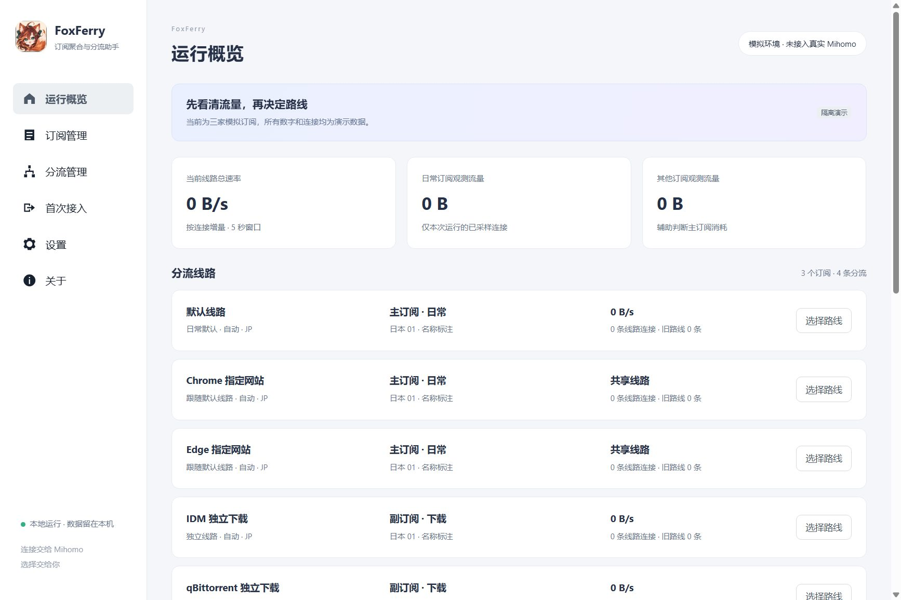
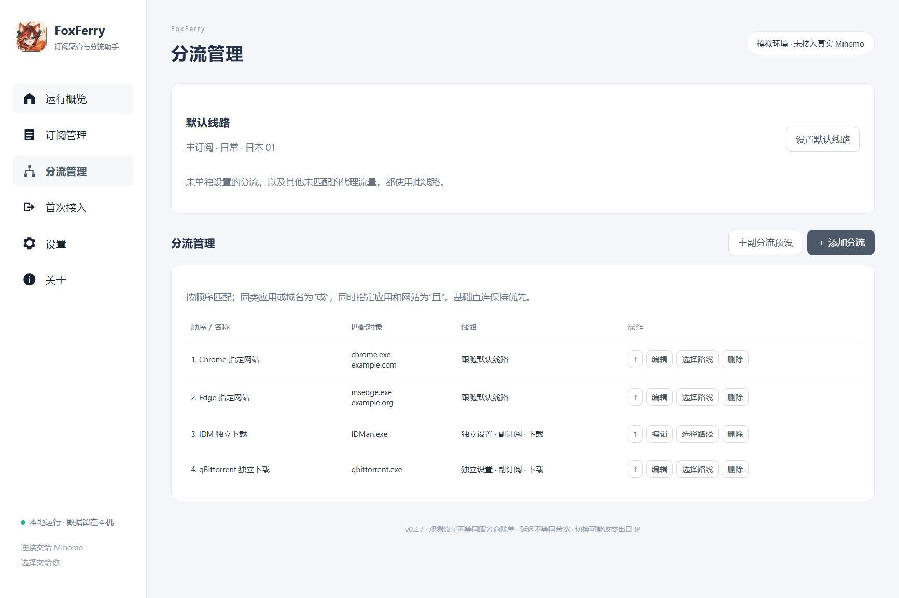

[简体中文](README.md) · [English](README.en.md)

  
  <h1>FoxFerry</h1>
  
<strong>Let every flow follow its own route.</strong>

  
A Windows subscription aggregation and routing companion for Clash Verge / Mihomo.

  
  

  
<a href="https://github.com/TxHuix0v0x/FoxFerry/releases">Downloads</a> · <a href="#quick-start">Quick start</a> · <a href="#features">Features</a> · <a href="docs/使用指南.md">User guide (Chinese)</a> · <a href="https://github.com/TxHuix0v0x/FoxFerry/issues">Report an issue</a>

## What is FoxFerry?

FoxFerry brings multiple proxy subscriptions into one place and helps different applications and websites use their own routes. For example, you can route IDM or qBittorrent through a secondary subscription while keeping everyday browsing on your primary subscription. Other entries can follow the default route.

It reuses your existing Mihomo engine through Clash Verge. **It is a companion, not a standalone proxy engine.** It organizes configuration, selects routes, and shows where observed connections actually went. It does not enable your system proxy, TUN, or DNS for you.

## See your routes at a glance

*Actual application screenshots, using synthetic demo data only. The pictured interface is in Chinese; this English README does not imply a translated application UI.*

## Features

### Subscriptions and routing

Aggregate several subscriptions while preserving node ownership, even when names overlap. Set independent routes for applications, websites, or combined conditions; let other entries follow the default route.

### Selection and recovery

Automatically select within the current subscription and locked country, or lock a node manually. Temporarily use another route and restore the original when traffic becomes idle.

### Understand observed connections

View the actual subscription, node, and sampled traffic. Ended records stay available for the current session. Lists show **newest first by first sampled discovery time**, not the exact connection creation time. Ending a connection does not reorder it. Subscription filters and frozen pagination use the same order.

### Tray shortcuts and personalization

Switch default or independent routes, including same-country automatic mode, from the tray while the main window is hidden. Customize backgrounds, panel opacity, and blur, and optionally follow Clash Verge's lifecycle. The About page provides repository and license links and manual stable-release checks, with no automatic downloads or installation.

*Routing management in the real isolated demo. No real subscription credentials are shown.*

## Quick start

1. Have **Clash Verge / Mihomo** installed and running on Windows x64.
2. Once the first stable release is published, download the installer and `SHA256SUMS.txt` from [Releases](https://github.com/TxHuix0v0x/FoxFerry/releases), verify the checksum, and install. The first public release is pending; packages are currently unsigned. For a portable build, keep the entire `win-unpacked` folder together.
3. Open the initial setup page, discover your Verge configuration, and import existing subscriptions. Set the default route and add application or website entries.
4. Generate the assistant-owned local configuration and activate it in Verge in rule mode. **Keep your original subscriptions; do not overwrite them.** Return to FoxFerry to confirm attachment.
5. Check actual connection ownership in Overview, then use the tray for quick route changes. Adjust follow behavior and background preferences in Settings; find repository, licenses, and manual update checks in About.

Detailed configuration and troubleshooting: [User guide (Chinese)](docs/使用指南.md). Backup and installation details: [Installation and upgrades (Chinese)](docs/安装与升级.md).

## Limits and privacy

- An existing Clash Verge / Mihomo installation is required. FoxFerry is not a proxy engine and does not change system proxy, TUN, or DNS settings for you.
- Route changes mainly affect new connections. Hot migration, unchanged exit IPs, and resumable downloads are not guaranteed.
- Traffic counters are sampled observations, not provider billing. History is kept in memory for the current session and disappears after a full exit.
- Automatic selection stays inside the configured subscription and country scope; latency is not a bandwidth guarantee. Supported subscription input is Mihomo YAML with a nonempty `proxies` list. See the guide for complex configurations.
- Update checks contact the project's public GitHub API only when requested. They do not upload subscription data, poll periodically, or download/install updates. Missing releases, offline errors, and rate limits are reported explicitly.

## Upgrades and contributions

Quit the old version, privately back up your actual user-data directory, and install to the existing location. Do not clear subscriptions or background settings just to upgrade. See [Installation and upgrades (Chinese)](docs/安装与升级.md).

Please report problems through [Issues](https://github.com/TxHuix0v0x/FoxFerry/issues) once the repository is publicly accessible. Never include credentials, subscription URLs, private paths, or unsanitized configuration.

Developers can restore dependencies with `npm ci`. Source submission and release instructions are in the [GitHub publishing guide (Chinese)](docs/GitHub发布指南.md). Installer files belong in Release attachments, not ordinary Git history.

## Vibe Coding

This project was built through Vibe Coding: I provide requirements, choose the direction, and test the real experience; AI handles most implementation, interface changes, and iterative debugging. If you find a problem, please open an Issue. I will keep improving the project with AI assistance.

Development uses Codex collaboration. Third-party code and components retain their own licenses and attribution.

## License and thanks

FoxFerry is available under the [MIT license](LICENSE). Thanks to Codex Maid Widget for the upstream HostGate adaptation, and to Electron, yaml, and other components. See the [third-party notices](NOTICE.md) for complete attribution and licensing details.
