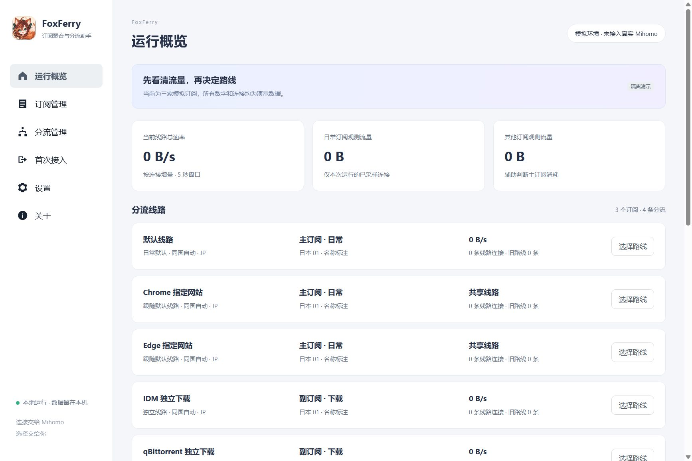
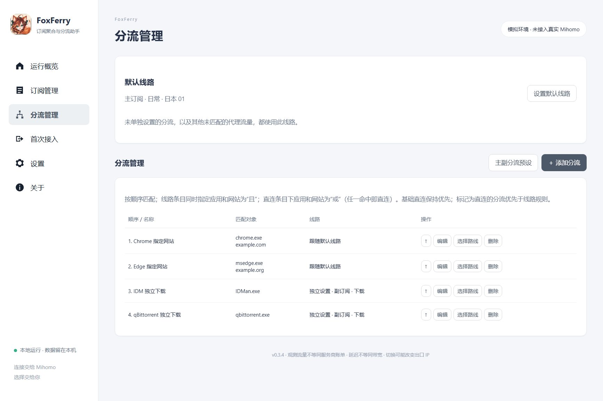

[简体中文](README.md) · [English](README.en.md)

  
  <h1>FoxFerry</h1>
  
<strong>让每一份流量，各行其道。</strong>

  
Windows 上的 Clash Verge / Mihomo 订阅聚合与分流助手。

  

    
    
    
  

  
<a href="https://github.com/TxHuix0v0x/FoxFerry/releases">下载最新版</a> · <a href="#快速开始">快速开始</a> · <a href="#功能介绍">功能介绍</a> · <a href="docs/使用指南.md">使用指南</a> · <a href="https://github.com/TxHuix0v0x/FoxFerry/issues">反馈问题</a>

## FoxFerry是什么？

FoxFerry 是与 Clash Verge / Mihomo 配套使用的 Windows 订阅聚合与分流助手。它把多家订阅和节点集中管理，让不同应用、网站或组合条件使用各自的线路。例如，可以让 IDM、qBittorrent 等不同的应用或网址使用副订阅，日常浏览继续使用主订阅；也可以保留默认线路，让没有单独设置的条目跟随它。

FoxFerry 复用你已有的 Mihomo 内核，负责组织配置、选择线路和展示连接归属，**不是独立代理程序**，也不会替你开启系统代理、TUN 或 DNS。

## 一眼看清流量与线路

*使用隔离演示的合成订阅和连接；不是实际机场或性能测量。*

## Vibe Coding

这是一个通过 Vibe Coding 完成的项目：我负责提出需求、决定方向和实际体验，AI 负责主要代码实现、界面调整与迭代排错。发现问题欢迎提交 Issue，我会和 AI 一起继续改进。

项目使用 Codex 协作开发；第三方代码和组件仍保留原许可及署名。

## 功能介绍

### 订阅与分流

集中管理多家订阅，跨订阅同名节点保留各自归属。为应用、网站或组合条件设置独立线路，其他条目可以跟随默认线路。

### 选线与恢复

在当前订阅和锁定国家内自动选优，亦可手动锁定，或按最低延迟跨国家自动切换（会提示出口 IP 变化与账号风险）。需要时临时使用其他线路，空闲后恢复原路线。订阅管理与选线窗口都可一键查询节点延迟。

### 连接可见

查看实际订阅、节点和观测流量，本次运行中最近 2000 条已结束记录仍保留。列表按**首次采样发现时间由新到旧**排列，结束不重新分组；订阅筛选与冻结翻页保持一致。首次发现时间不等于准确的连接建立时间。

### 托盘与个性化

关闭主窗口后，可在托盘快捷切换默认/独立线路及同国自动。支持自定义背景、面板透明度与模糊，也可跟随 Clash Verge 启停。关于页提供项目仓库、许可和手动稳定更新检查；更新只在点击时查询，不自动下载或安装。

*分流管理实机截图，同样仅含合成演示数据。*

## 快速开始

1. 准备已有的 **Clash Verge / Mihomo**。FoxFerry 是助手，不是独立代理内核。
2. 从[下载页面](https://github.com/TxHuix0v0x/FoxFerry/releases)获取安装 EXE，核对后安装。程序包目前未签名。
3. 打开「首次接入」，发现已有 Verge 配置并读取订阅；在「分流管理」选择默认线路、添加应用或网站规则。
4. 生成并在 Verge 中启用「助手专用」本地配置，再回到 FoxFerry 确认接入。**保留原订阅，不覆盖它们。**
5. 在运行概览核对连接实际归属；后续可使用托盘快捷切换。

详细接入、背景设置、临时加速及故障边界见[使用指南](docs/使用指南.md)。安装与备份步骤见[安装与升级](docs/安装与升级.md)。

## 使用边界

- 需要已有 Clash Verge / Mihomo；FoxFerry 不替你开启或修改系统代理、TUN、DNS。
- 切换主要影响后续新连接，不承诺连接热迁移、出口 IP 不变或下载续传。
- 观测流量不是机场账单；连接历史仅在本次运行内存中，完整退出后清空。
- 自动选优限制在既定订阅和国家范围；不保证真实带宽。支持含非空 `proxies` 的 Mihomo YAML，复杂源配置的限制见指南。
- 检查更新只在点击时请求公开 GitHub API，不定时查询、不上传订阅、不自动下载或安装；无 Release、离线或限流会明确提示。

## 升级与参与

退出旧版并备份实际用户数据，再安装到原位置。不要为升级清空订阅或背景；详见[安装与升级](docs/安装与升级.md)。

问题与建议可提交到[Issues](https://github.com/TxHuix0v0x/FoxFerry/issues)。不要附上订阅链接、凭据、私人目录或未经脱敏的配置。

开发前执行 `npm ci`；测试、源码清单和公开上传步骤见[GitHub 发布指南](docs/GitHub发布指南.md)。安装包作为 Release 附件，不进入普通 Git 历史。

## 许可与致谢

FoxFerry 采用 [MIT 许可证](LICENSE)。感谢 Codex Maid Widget 的 HostGate 上游改编来源，以及 Electron、yaml 等组件。完整许可与署名见[第三方声明](NOTICE.md)。
